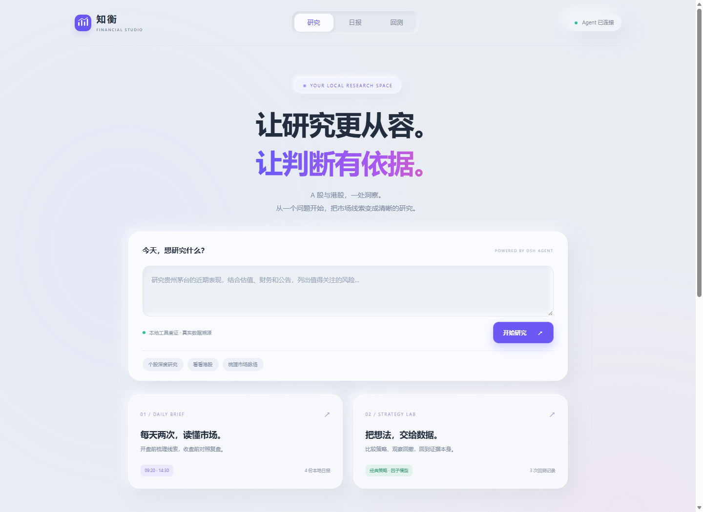
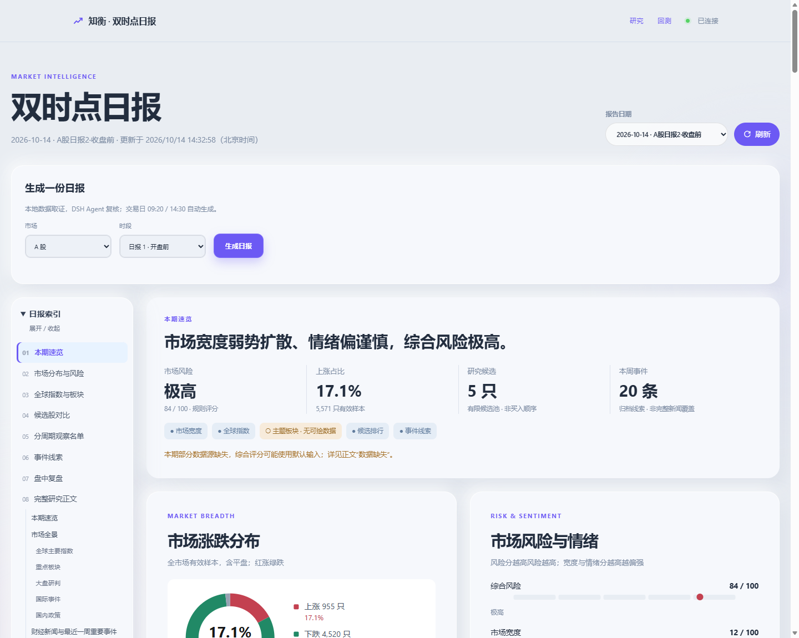
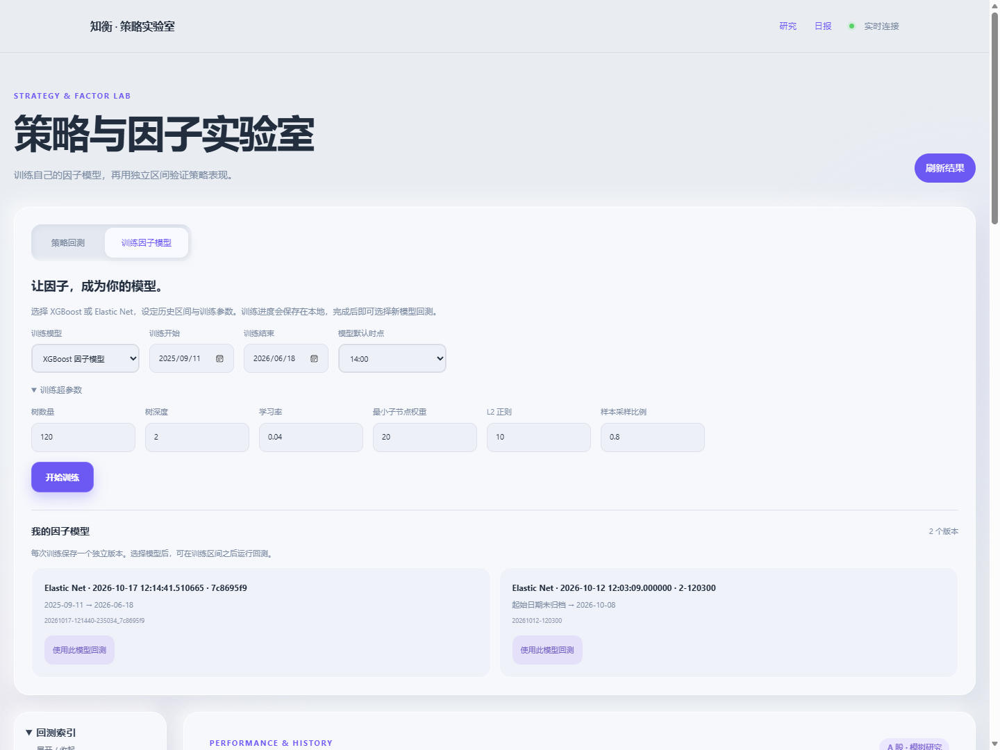

<div align="center">
  
  <h1>知衡 · Financial Studio</h1>
  <p>让研究更从容，让判断有依据。</p>
  <p>本地网页 · DSH Web Agent · A 股 / 港股 · Soft UI</p>
  <p><a href="#开始使用">开始使用</a> · <a href="docs/web-workspace.md">使用指南</a> · <a href="docs/README.md">完整文档</a></p>
</div>



## 开始使用

准备 **Node.js 22.13+、Python 3.11+**，在项目目录运行：

```sh
npm start
```

Windows 也可双击 `start.bat`；Linux / macOS 运行 `bash start.sh`。首次启动自动检查依赖并注册插件。默认打开 **http://127.0.0.1:3205**，端口被占用时自动选择空闲端口，以终端地址为准。

页面会显示可复制的**局域网访问地址**，供同网其他设备使用；自动选择物理以太网 IPv4，跳过虚拟网卡。

在 **DSH Web → 模型设置**配置 API Key。知衡直接使用 DSH 的默认模型、凭据与 Agent，无需另配 Key。支持 DSH Web 0.2.0 系列（最低 0.2.0-rc.2）。

## 三个空间，一条研究路径

| 页面 | 可以做什么 |
| --- | --- |
| **研究** `/` | 提问并调用本地金融工具，保存分析与任务记录 |
| **日报** `/reports` | 双时点日报、持仓文本录入、市场线索与午后复盘 |
| **回测** `/backtests` | 比较经典策略、训练因子模型，查看净值、回撤与交易明细 |

训练入口：**回测 → 训练因子模型**，支持 XGBoost / Elastic Net、日期与超参数设置，完成后可直接选择新模型回测。

21 个研究工具、8 个 Skills，复用原有取数、快照与回测引擎。日报默认在交易日北京时间 **09:20 / 14:30** 本地生成；服务需要保持运行。

<details>
<summary>日报与回测截图</summary>





</details>

`npm run dev` 启动但不打开浏览器；`npm stop` 停止工作台；`npm run dsh:register` 重新注册插件。更多启动配置、数据目录和故障处理见[网页指南](docs/web-workspace.md)。

研究与模拟结果不代表未来收益，不连接券商或执行交易。[研究约束](docs/research-guide.md) · [回测口径](docs/backtest-audit.md)

本项目采用 [MIT 许可证](LICENSE)。
