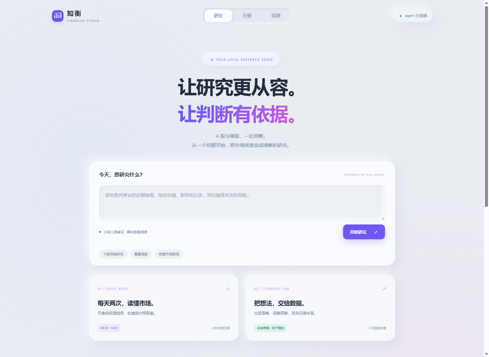
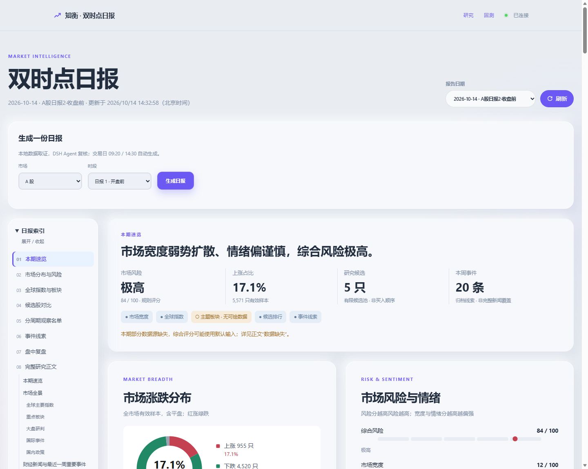
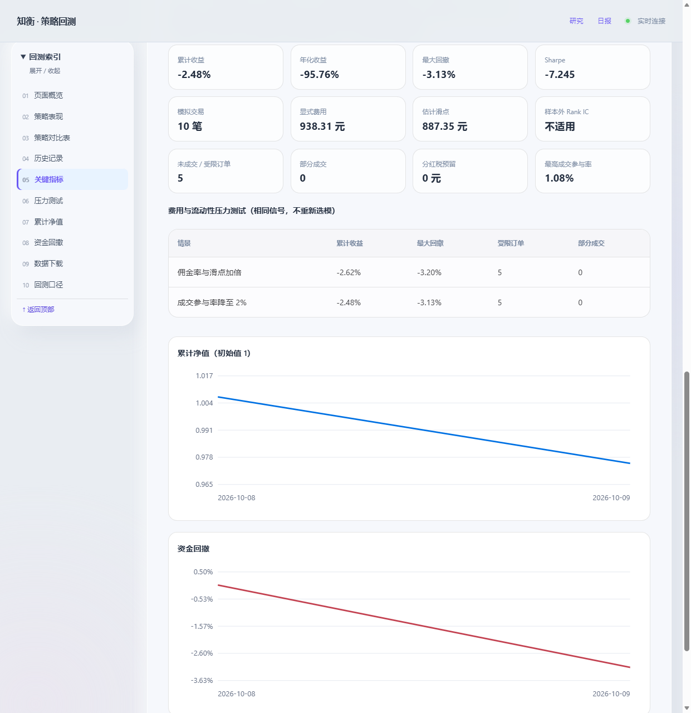
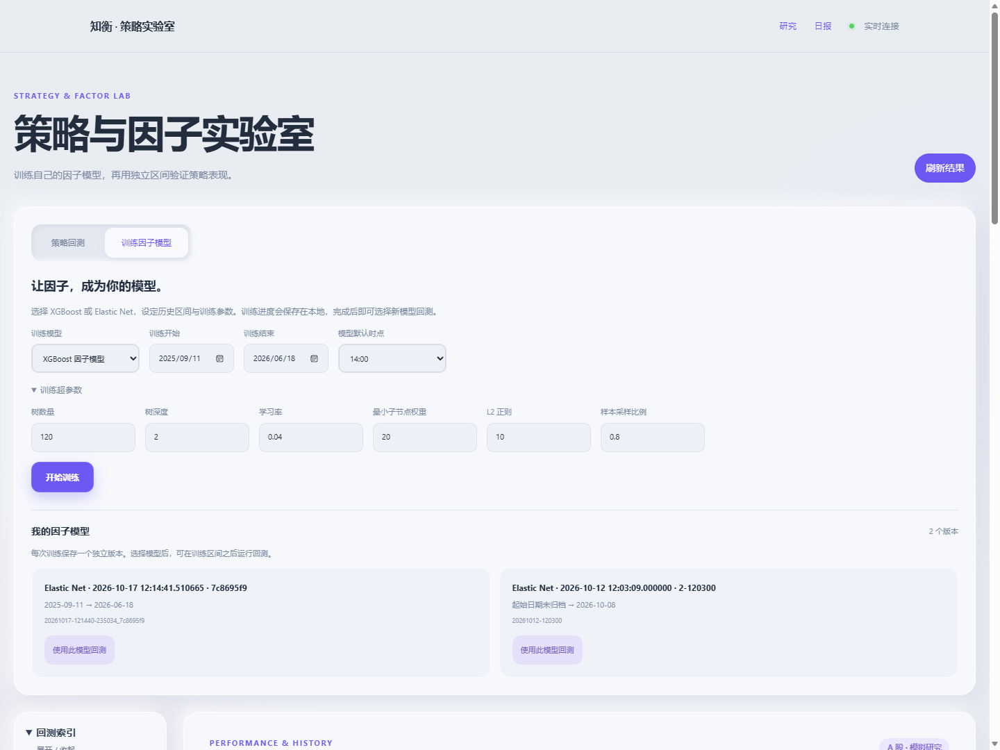

<div align="center">
  
  <h1>知衡 · Financial Studio</h1>
  <p>让研究更从容，让判断有依据。</p>
  <p>本地网页 · DSH Web Agent · A 股 / 港股 / 美股 · 研究与模拟</p>
  <p><a href="#开始使用">开始使用</a> · <a href="docs/web-workspace.md">使用指南</a> · <a href="docs/README.md">完整文档</a></p>
</div>

<!--  -->

## 开始使用

Windows 双击 **`start.bat`**；Linux / macOS 运行 **`bash start.sh`**。自动检查 Node.js、npm、DSH、pnpm、Python 和数据依赖：缺失或低于要求时补齐升级，满足要求的高版本直接复用。

已有 Node.js 环境也可在项目目录运行：

```sh
npm start
```

启动时自动注册插件：已有 **DSH Web** 则复用并加载知衡，没有则自动启动。默认打开 **http://127.0.0.1:3205**，端口被占用时自动选择空闲端口，以终端地址为准。

页面会显示可复制的**局域网访问地址**，供同网其他设备使用；自动选择物理以太网 IPv4，跳过虚拟网卡。

在 **DSH Web → 模型设置**配置 API Key。知衡直接使用 DSH 的默认模型、凭据与 Agent，无需另配 Key。支持 DSH Web 0.2.0 系列（最低 0.2.0-rc.2）。

## 研究工作台

| 页面 | 可以做什么 |
| --- | --- |
| **研究** `/` | 提问并调用本地金融工具，保存分析与任务记录 |
| **日报** `/reports` | 定时及手动报告、市场线索、复盘与多市场策略部署 |
| **持仓** `/portfolio` | 文本或截图录入、行情图表、持仓分析与持仓池回测 |
| **回测** `/backtests` | 按市场和日/周/月 K 线比较策略、训练模型，查看净值、回撤与交易明细 |
| **模拟** `/simulation` | 独立账本、策略调仓、AI 分析、暂停恢复与追加模拟资金 |
| **策略解读** `/strategy-guide` | 查看经典策略与模型的信号、适用情形和限制 |
| **设置** `/settings` | 选择 DSH 模型及推理强度、切换深浅主题 |

训练入口：**回测 → 训练因子模型**，支持 XGBoost / Elastic Net、日期与超参数设置，完成后可直接选择新模型回测。

21 个研究工具、11 个工作台工具、10 个 Skills。支持 A股、港股、美股及按市场/周期隔离的策略模型。A股和港股定时日报为北京时间 **09:20 / 14:30**，美股为纽约时间 **09:20 / 15:30**，提前收市日相应提前；可手动生成独立归档报告。服务需要保持运行。

模型默认跟随 DSH，也可在知衡设置中选择已配置模型；API Key 继续由 DSH 管理。图片识别需模型支持图片输入，结果先填入文本框供核对。

<details>
<summary>日报与回测截图</summary>





</details>

`npm run dev` 启动但不打开浏览器；`npm stop` 停止工作台；`npm run dsh:register` 重新注册插件。更多启动配置、数据目录和故障处理见[网页指南](docs/web-workspace.md)。

本次功能对齐基准与验证见[同步记录](docs/alignment-2026-11.md)。开发检查：`npm test`、`npm run test:python`；可设置 `FINANCE_BROWSER_TESTS=1` 运行无头浏览器回归。

研究与模拟结果不代表未来收益，不连接券商或执行交易。[研究约束](docs/research-guide.md) · [回测口径](docs/backtest-audit.md)

本项目采用 [MIT 许可证](LICENSE)。
