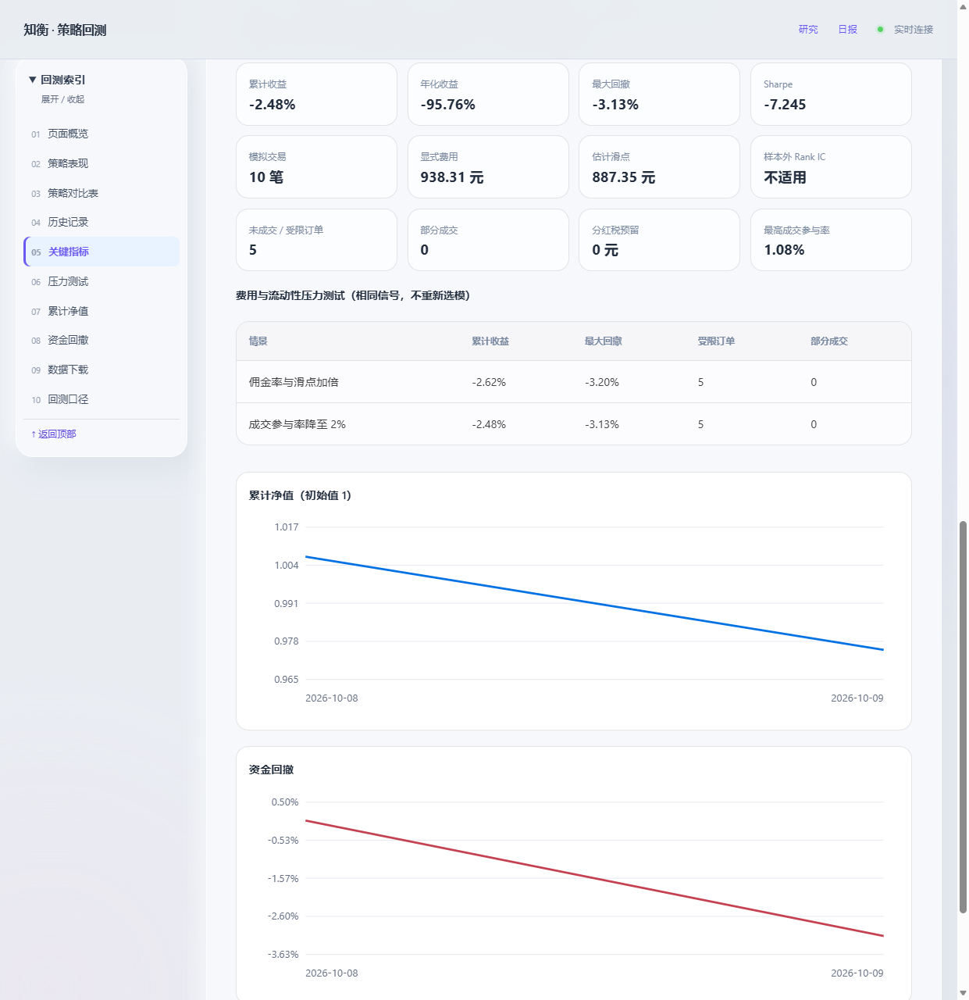
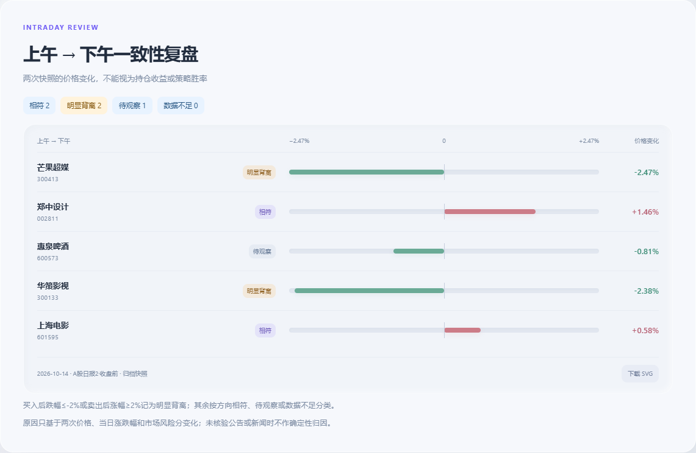

# 网页迁移与回测验收

验收环境：Windows、Node.js 24.21.0、Python 3.11、DSH 0.2.0-rc.2。验收日期：2026-10-17。

## 数据修复

原始 BaoStock 公司行为缓存中的 18 条送转股事件都有 `dividStockMarketDate`；旧 `market-state.csv` 没有保存 `stock_credit_date`，旧清单只有 `validated`，不能代表符合新版数据契约。网页现在先检查清单版本、字段、上市日期、预热标记和文件哈希；旧数据会自动重建并重新验收，失败时不会进入回测。

本次网页任务重建了 2025-09-08 至 2026-10-09 的历史输入：

- 260 个交易日、418 只股票通过验收；18 条送转股事件均保留原始上市日期，无缺失日期。
- 补齐 13 只股票首次入池前的预热分钟线，仅请求缺少的日期。
- 601091 在 2026-09-21 的异常分钟成交额使用随项目保存、通过哈希与日线金额核对的新浪修正数据恢复。原始数据和修复记录仍保留。
- 验收清单为 `data_schema_version: 2`、`feature_warmup_validated: true`；缺失交易日和预热日均为 0，issues 为空。

## 真实网页回测

在 `/backtests` 选择盘中动量、2026-10-08 至 2026-10-09、14:00 信号，点击“运行回测”。任务完整成功，结果归档为 `20261017-023319-922052-momentum`，使用引擎版本 6。

浏览器实际展示净值、回撤、关键指标和压力测试，并成功点击下载两项 CSV：净值 2 行、模拟交易 10 行。此次仅验证功能链路，不据此评估策略有效性。截图：

修复了 Windows 标准输入退出监控阻塞多进程初始化的问题：现在使用仅请求 SYNCHRONIZE 权限的进程句柄，计算进程监控网页进程与直接父进程，不阻塞标准输入。真实 NumPy 多进程测试和网页回测均通过。

## 因子训练与复盘图

策略实验室顶部提供“策略回测 / 训练因子模型”标签，训练页直接展示 XGBoost / Elastic Net、日期和可调超参数。“我的因子模型”显示独立版本和训练区间，并可一键带入模型回测。任务配置随任务保存，运行中刷新网页会恢复实际模型、日期、信号时点和参数；快捷回测的默认区间按所选版本重新计算，避免继承其他模型的边界。

通过真实网页训练 Elastic Net，区间 2025-09-11 至 2026-06-18，参数 `alpha_scale=0.01`、`l1_ratio=0.5`、`max_iter=10000`。训练成功保存版本 `20261017-121440-235034_7c8695f9`，覆盖 181 个交易日、50,652 条成熟样本，旧模型继续保留。

随后在模型卡片点击“使用此模型回测”，验证默认开始日期为 2026-06-19；再选择 2026-10-08 至 2026-10-09、14:00 实际运行。新模型回测成功归档为 `20261017-122152-843027-elastic_net`，引擎版本 6，冻结该 checkpoint，训练标签结束日 2026-06-17。浏览器显示两条曲线，实际下载净值 CSV（2 行）和交易 CSV（12 行）。回测成功后自动选中新结果；定时刷新仍保留用户手动选择的历史记录。两日样本只用于功能验收。

日报复盘图改为固定字号、细条形和独立分类标签，保留同图对称刻度、精确值、归档日期和 SVG 下载。桌面与 390px 手机视口已人工检查，训练表单没有横向溢出；浏览器实际下载 SVG，并检查归档日期和精确涨跌值。

## 局域网访问

Windows 实机识别 `Intel(R) Ethernet Controller I226-V` 的物理以太网 IPv4 `192.168.10.106`，跳过 VMware VMnet1 / VMnet8、未连接 WLAN 和自动分配地址。主服务监听 `0.0.0.0:3205`，内部 Python 服务仍仅监听回环地址。首页、日报、回测页均显示 `http://192.168.10.106:3205` 和复制按钮。

已通过该以太网 IP 在本机浏览器访问三类页面，并在无 Clipboard API 的 HTTP 环境验证复制成功。390px 视口下日报及训练页地址正确、无横向溢出和脚本错误。自动测试覆盖虚拟/断开/无线网卡排除、多物理网卡路由优先级、Windows 通配监听下的端口冲突回退、实际端口 URL、同源写入及拒绝虚拟地址 Host / 外部 Origin。

## 文本持仓录入

入口现为“管理持仓”，下方已保存列表支持逐条编辑股数与删除，A 股和港股均可操作。编辑保留名称、成本和备注；删除最后一条可保存为空列表。服务端加锁读取最新列表并原子替换缓存，无效股数、无效代码、已不存在的记录均不写入；文本识别任务运行期间暂缓编辑。

在真实浏览器中拦截持仓 API，使用隔离示例数据完成两种市场的编辑、刷新读取、Esc 取消、删除失败重试、删除最后一条、390px 手机编辑及无横向溢出检查，页面无 JavaScript 运行错误。Python 临时持仓文件验证实际持久化及元数据保留；Node HTTP 测试验证路由、同源限制、输入校验和导入冲突处理。用户现有持仓文件验收前后 SHA-256 一致。

在日报页提供“添加持仓”入口，支持股票代码 + 股数的自然文本、A股/港股混合输入。DSH 复用宿主模型与凭据，只开放只读 `stock_search`；服务端按原文核对代码和数量，区分市场，校验重复、非整数、按手和模糊数量。名称优先复用已有缓存或 AKShare 目录，港股主源不可用时通过腾讯逐代码返回结果核对代码再补全名称。

真实 DSH `deepseek-flash` 预览识别 `600519 100股` 和 `港股 00700 200股`，成功返回贵州茅台、腾讯控股及对应市场和数量。预览明确标注“尚未保存”；验收前后用户现有10条持仓文件哈希一致。桌面和390px手机视口均检查，无横向溢出。

保存行为在隔离临时缓存测试中验证：相同代码更新总股数，重复提交不累加，其他持仓、原成本和备注保留；一条无效记录会阻止整批保存。名称补全期间取消不进入写入步骤。实际写入使用原子替换，预览与补全接口不写缓存。持仓缓存及任务记录均被 Git 忽略。

## 清理与回归

DSH Web 复用另作实际验收：没有 Web 服务时从双击入口启动 `web` profile，知衡回到 `3205`；再次启动仍是同一 Web PID。执行 `npm stop` 后知衡的 `3205` 监听消失，共享 Web `3080` 与四个插件的端口继续存在；再次双击在原 PID 中热加载知衡并恢复 `3205`。插件清理由 Cordis `effect` 生命周期管理，状态文件按实例标识清理，避免热加载遗留监听或删除新实例状态。持仓文件哈希保持不变。自定义 Web 端口、启动过程中的服务、端口占用、身份识别、启动失败只清理自建进程及认证日志脱敏由隔离测试覆盖。

双击入口已接入 Node 自举，并实际运行 `start.bat --no-open` 验证启动与复用。当前 Node 24.21.0、npm 11.19.0、DSH 0.2.0-rc.2、pnpm 12.4.2、Python 3.11.7 及数据依赖均直接复用。插件全新启动、插件复用已有服务、启动器复用三种路径均输出真实以太网 URL 与当前端口。Windows 隔离测试模拟 Node 缺失、低于 22.13、带空格路径、校验失败保留旧环境及参数传递；工具与 Python 测试覆盖低版本升级、高版本复用、依赖补齐与失败阻止启动。Node 官方固定版本的 Windows x64/ARM64 校验清单实际返回 HTTP 200；Linux/macOS 启动脚本通过 Bash 语法检查，未作跨系统安装实测。

- 删除 Tk 桌面面板、专用启动/安装/服务/更新脚本、兼容入口及桌面和旧服务测试。原来依赖面板的缓存校验迁移至 `backtest_cache.py`；有用的数据验收与 checkpoint 测试继续保留。
- 核实三个旧 Windows 计划任务的工作目录及执行路径后导出备份并移除。XML 备份保存在本地 `.runtime/retired-tasks/`。当前调度统一由网页插件管理。
- Python 完整测试：219 项执行完成，1 项跳过，其余通过；不再排除桌面测试类。
- JavaScript 回归：63 项通过，含 5 项 Git 忽略与凭据保护测试。浏览器回测结果页控制台无错误，净值与交易明细下载成功。
- 四个参考项目没有修改。

研究工具、统计假设和数据来源限制仍适用；没有放宽送转股上市日、T+1、历史股票池或分钟线验收条件。
