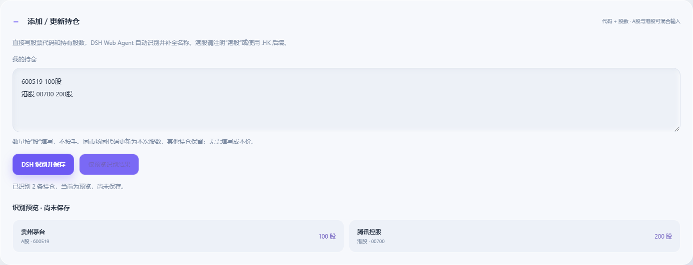

# 网页工作台

[返回首页](../README.md)

## 启动与插件

需要 Node.js 22.13+、Python 3.11+。运行 `npm start`、Windows 的 `start.bat` 或 Linux/macOS 的 `bash start.sh`。首次运行会检查并安装 Python 数据依赖、兼容的 DSH 和 pnpm；项目不需要前端编译。`npm run dev` 不自动打开浏览器。

默认监听 `127.0.0.1:3205`。占用时直接让操作系统分配空闲端口，终端输出实际地址。重复启动会复用已运行的知衡。`FINANCE_PORT` 可指定首选端口，`FINANCE_PYTHON` 可指定 Python。`npm stop` 停止当前工作台。启动和停止统一使用 `start.bat` / `start.sh`、`npm start` / `npm stop`，旧桌面入口已删除。

启动器使用 DSH 官方 `plugin --profile web add link:...` 注册根目录包 `dsh-financial`，并移除被其替代的 `dsh-finance-agent` 注册，避免重复工具。其他插件和其他四个项目不作修改。名称、简介、图标分别来自 `locale/`、`package.json` 和 `web/icon.svg`。

最低兼容 DSH `0.2.0-rc.2`，接受 `0.2.0` 正式版及更高版本。启动时复用系统或共享 DSH；不足时安装固定兼容版本。当前验证环境为 `0.2.0-rc.2`，未声称已在不存在于本机的正式版上实测。

## Agent 和模型

知衡在 DSH 内运行，通过 `ctx.agents.create` 创建研究会话，继承 `agentDefaultModel`。API Key、模型提供方、协议和端点由 DSH 管理。独立启动时采用应用 profile，直接引用用户 `DSH_HOME` 中的 `settings.yaml` 和 `.credentials.yaml`，不复制密钥、不提供单独 Key 输入框。

在 DSH Web 的模型设置中配置凭据。应用 profile 观察配置更新；若宿主版本不热更新模型，请重启知衡。运行 `npm run dsh -- web` 可进入 DSH Web；已有 Web 进程需要在注册后加载插件或重启一次。网页的研究工具限制在金融工具范围内，不向研究会话开放任意终端执行。

DSH Web 插件与独立启动器共用项目的运行状态：已运行时复用网页和取数服务。原有 21 个研究工具和 8 个 Skills 仍然注册。研究结果包含会话 ID、实际模型和调用工具列表。任务在本地保存，支持取消；服务重启后，旧的运行中任务被标记为中断。

## 页面

| 路由 | 功能 |
| --- | --- |
| `/` | 研究输入、快捷问题、真实任务记录、连接状态 |
| `/reports` | 手动生成 A 股/港股两期日报、归档选择、市场图表、持仓分析、全市场策略部署 |
| `/backtests` | 选择策略/checkpoint、训练模型、设置日期/信号时点/超参数、回测曲线与 CSV 下载 |

日报先由原有数据引擎取证并保存快照，再经 DSH Agent 复核，完成后原子写入归档并通知页面。非交易日跳过；Agent 失败时不会把半成品写为新日报。默认在北京时间 09:20、14:30 调度，复用 `config/daily-push.json` 中的 enabled、market 和 schedules。仅在服务运行且到达计划时刻时触发，不补发错过的日报。新网页调度只归档本地，不发送 Webhook。

训练和回测使用原有 Python 引擎，数学逻辑与验收标准不变。旧格式缺少红股上市日期、预热标记，输入哈希损坏，缺少历史数据或区间未覆盖时，自动准备并验收；取数、验收、训练标签边界、数据时点或 checkpoint 校验失败时保留具体失败原因。训练与回测是两个独立任务，不隐式训练模型。第一次大区间数据准备可能较慢，可查看运行日志和取消任务。

在策略实验室点击 **训练因子模型**（也可直接打开 `/backtests?mode=train`），选择 XGBoost 或 Elastic Net，设置训练日期、信号时点与超参数，点击“开始训练”。任务可在后台继续，刷新页面后恢复进度。成功后“我的因子模型”会出现独立版本和训练区间；点击“使用此模型回测”，自动选中该版本，并把回测开始日期限制到训练标签结束之后。旧版本继续保留。

日报的一致性复盘采用与页面统一的紧凑条形布局。涨跌使用同一对称刻度，方向相符与否单独标注，缺失价格显示“—”；归档日期、分类口径和 SVG 导出继续保留。

## 文本录入持仓

在日报页点击“添加持仓”，直接输入代码与当前持股数量，可混合 A 股和港股：

```text
600519 100股
000858 200股
港股 00700 300股
```

港股也可写 `00700.HK 300股` 或 `HK00700 300股`。数量按股填写，不按手；支持 `1,000股`、`1.5万股`。无需输入成本或股票名称。点击“DSH 识别并保存”，复用 DSH Web 配置的模型解析原文，并通过本地缓存、AKShare 股票目录和腾讯备用来源补全名称。

同市场同代码更新为本次总股数，不累加；未提及的持仓、原成本和备注保留。“仅预览识别结果”不会保存。识别数量与原文不符、代码重复或信息不明确时整批停止，不写入部分记录。名称源暂不可用时保留代码、市场和股数，并标明缺失情况。

保存位置为 `data/portfolio.json`，已被 Git 忽略。保存成功后已有持仓分析失效，点击“分析我的持仓”获取新结果。




## 本地数据与访问

`data/reports/` 存日报，`data/factor-lab/` 存历史数据、模型与回测，`data/web/` 存任务和调度记录。`.runtime/` 为启动状态和临时 profile。这些目录均忽略提交。内部 Python 服务使用随机回环端口，由插件管理；主进程关闭后工作进程自动退出。

启动时识别已连接的物理以太网 IPv4，排除 VMware、Hyper-V、VPN、虚拟网卡、无线网卡和自动分配的 `169.254.*` 地址；多块物理以太网优先使用默认路由度量最低的网卡。首页、日报和回测页均显示局域网 URL 与复制按钮，端口使用实际监听端口（包括占用后自动分配的端口）。没有符合条件的网卡时仅保留本机访问并显示原因；网卡地址变化后重启工作台。

检测到以太网时主网页监听 IPv4，允许通过本机或选定的以太网 IP 访问，并继续校验 Host、实际端口及写请求 Origin。其他设备需在同一局域网，Windows 防火墙需允许当前 Node.js 程序入站访问；内部 Python 端口仍只监听本机。

回测与报价只用于研究，不执行交易。数据源可用性和延迟依赖原有公共数据服务；缺失值不会用示例数据填充。

## 验证

```powershell
npm test
$env:PYTHONUTF8='1'
$env:TEMP=(Join-Path $PWD '.test-tmp'); $env:TMP=$env:TEMP
.\.venv\Scripts\python.exe -m unittest discover -s tests
```

工具定义和研究约束参考 [工具与市场](tools-and-markets.md)、[因子研究](factor-lab.md) 和 [回测审计](backtest-audit.md)。
